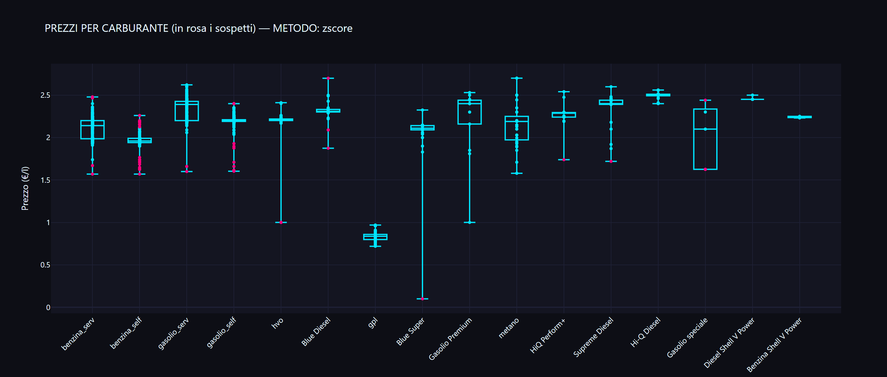

# Analisi prezzi dei carburanti a Roma

Progetto personale di analisi dati · 2026 · **in corso: fase 1, audit dei dati completato**.

**Domanda di partenza:** quanto costa fare rifornimento a Roma, da cosa dipende il prezzo (marchio, self o servito, tipo di impianto) ed esistono zone della città dove conviene di più?

È il primo passo di un lavoro più grande: qui costruisco la pipeline e le funzioni riutilizzabili su un dataset piccolo, per poi applicarle all'archivio nazionale dei prezzi MIMIT dal 2015 al 2026 (circa 7 GB).

## Dati
- **Fonte:** MIMIT, Osservatorio Prezzi Carburanti, distribuiti da AgID nel pacchetto [Dati aperti comunali - Roma](https://www.dati.gov.it/view-dataset/dataset?id=ccf35d25-af96-4977-a6ad-853aa055eac6) su dati.gov.it.
- **File:** `data_raw.json`, fotografia del 12/11/2026: **946 impianti**, 24 colonne (marchio, tipo, coordinate, indirizzo, data dell'ultimo aggiornamento, prezzi di 7 carburanti principali e 9 prodotti extra).
- **Licenza dei dati:** Italian Open Data License 2.0 (IODL 2.0). Il file è incluso nella repository, con attribuzione alla fonte.

## Cosa ho fatto finora: l'audit
1. **Struttura e tipi:** controllo di righe, colonne e tipi; `id` convertito in testo e data dell'ultimo aggiornamento in formato data.
2. **Valori mancanti:** 121 impianti non hanno nessun prezzo e nessuna data.
3. **Duplicati** rispetto a id, nome, indirizzo e coordinate, con verifica di alcuni casi su Google Maps.
4. **Valori anomali dei prezzi:** confronto di tre metodi (distanza dalla mediana, z-score, IQR) su un box plot interattivo; scelto lo z-score, con la mediana come ripiego per le colonne con pochi valori.
5. **Aggiornamenti:** distribuzione dell'età dei prezzi e soglia di 7 giorni per considerare un impianto aggiornato.
6. **Confronto con i KPI della fonte:** numero di impianti, bandiere e quota di impianti aggiornati coincidono con i miei calcoli.



## Risultati principali dell'audit
- **Molti outlier sono prezzi vecchi, non errori:** tra gli impianti con data solo il 3,4% non è aggiornato, ma tra i prezzi sospetti la quota sale al 40% (19 su 47).
- La soglia di **7 giorni** riproduce esattamente l'indicatore di aggiornamento della fonte (84,2% degli impianti).
- **Errori nei dati:** un prezzo a 0,10 €/l, 3 impianti con coordinate fuori dal comune, 21 impianti con coordinate identiche (in un caso tre impianti di uno stesso gestore hanno le coordinate di un quarto), 11 indirizzi condivisi da due impianti.
- Il 20,7% degli impianti ha prezzi di prodotti extra, quasi tutti di marca: li tratterò in un dataset separato.
- Gli impianti non aggiornati (149) non entrano nell'addestramento dei modelli: formano il **prediction set**.

## Prossimi passi
1. **Pulizia:** correzione o esclusione dei casi segnalati, dataset separati per carburanti principali e prezzi extra.
2. **Analisi esplorativa** delle differenze di prezzo per marchio, tipo di impianto, self e servito.
3. **Zone di Roma con il machine learning:** clustering delle coordinate e confronto dei prezzi tra zone.
4. Applicazione delle funzioni all'**archivio nazionale MIMIT 2015-2026**.

## Contenuto
| File | Cosa contiene |
|---|---|
| `analisi_carburanti_roma.ipynb` | Notebook: setup, funzioni riutilizzabili, audit completo; le sezioni successive sono la traccia dei prossimi passi |
| `data_raw.json` | Dati grezzi (fonte MIMIT, IODL 2.0) |
| `snippets_markdown.ipynb` | Le legende dei colori e gli elementi Markdown che uso nei notebook |
| `environment.yml` | Ambiente conda per riprodurre l'analisi |
| `img/` | Grafici per questo README |

I grafici interattivi (Plotly) e le tabelle interattive non si vedono nell'anteprima di GitHub: per vederli si può aprire il notebook con [nbviewer](https://nbviewer.org/) o in locale.

## Come riprodurre
```bash
conda env create -f environment.yml
conda activate data_science
jupyter lab
```

## Strumenti
Python, pandas, NumPy, Plotly, matplotlib, seaborn, itables, Jupyter. Ho usato strumenti di IA come supporto per alcune funzioni e per la revisione del notebook.

**Autore:** Aleksandar Savov · [Portfolio](https://ksandariv.github.io)
